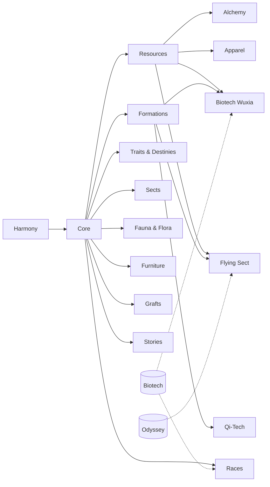

# Convergence: Era of Cultivation — documentación técnica y guía de publicación en Steam Workshop

Fecha: 2026-10-20. Estado: versión `0.1.0` de los 15 mods (etiqueta `v0.1.0` de este repositorio).
Este documento junta (1) qué es el mod y cómo está armado, (2) qué hace cada módulo, (3) qué hay que saber del Workshop y (4) el paso a paso
para subirlo de a poco. Los textos listos para pegar en las páginas del Workshop están en [WORKSHOP_TEXTOS.md](WORKSHOP_TEXTOS.md).
Antes de cada subida: `python -I tools/check-workshop.py` (revisa lo que bloquea o estropea una subida).

---

## 1. Resumen

**Convergence: Era of Cultivation** es un mod de RimWorld 1.6 de **Prospero1088** (prefijo `CVG_`, namespace C# `Convergence`) de cultivo xianxia/wuxia
inspirado en *Tale of Immortal* y en el subgénero del renacimiento del qi: un fragmento de los Nueve Cielos choca con el mundo, el qi empieza a
fluir y los colonos con raíz espiritual cultivan, avanzan de reino, sufren tribulaciones y aprenden técnicas. Se juega **con tecnología**
(tecno-cultivo) **o sin ella** (cultivo clásico): el Core nunca exige electricidad ni investigación industrial.

Está partido en **15 mods**: un Core (el framework) y 14 módulos que dependen de él. Cada módulo es un mod aparte y se puede instalar solo.

| Cifra | Valor |
|---|---|
| Mods | 15 (Core + 14 módulos) |
| Definiciones XML (`defName`) | ≈ 1 280 (368 ThingDef, 132 GeneDef, 122 BackstoryDef, 111 StoryEventDef, 102 HediffDef, 67 RecipeDef, 63 TraitDef, 52 AbilityDef, 51 PawnKindDef…) |
| Texturas PNG | 864 (+15 vistas previas) |
| Código C# | ≈ 24 200 líneas en 5 DLL (Core 643 KB, Stories 145 KB, Formations 37 KB, QiTech 19 KB, Grafts 12 KB) |
| Parches Harmony | 60 clases de parche + 8 parches manuales |
| Idiomas | English (base, en los defs), Spanish, SpanishLatin (Keyed + DefInjected) |
| Peso total | ≈ 40 MB (Core 9,2 MB; el mayor, Furniture 6,5 MB) |
| Licencia | Código, scripts y contenido técnico: **MIT**. Arte original, lore y texto narrativo: **CC BY-NC-SA 4.0**. Lo derivado de RimWorld (145 texturas) y el material de terceros no lo licencia el autor (se lista aparte, con lo que permite el EULA). Arte hecho con asistencia de IA |
| Requisito externo | **Harmony** (Workshop 2009463077). Ningún otro mod |
| Probado con | RimWorld 1.6.4871, todas las DLC y 37 mods de terceros a la vez (ver §6) |

Decisiones de diseño firmes (de `CLAUDE.md`): todo lleva lore (2-3 frases en inglés en el def y en español en DefInjected); de casi todo lo que ya
funciona en el juego se hace **su versión wuxia** (misma mecánica, otra estética: electricidad → red de qi, mecanitor → titiritero, gravnave →
isla voladora, psycasts → técnicas); integración con todos los sistemas y todas las DLC (ver [INTEGRACION.md](INTEGRACION.md)); las sectas **no**
son anti-tecnología (eso lo decide la Ideología del jugador).

---

## 2. Mapa de módulos y dependencias

Dependencias **duras** = las que el juego exige (`modDependencies` del About). Carpetas `Mods/<X>` = contenido que solo se carga si X está activo
(`LoadFolders.xml`, `IfModActive`); sin ese mod o DLC el módulo funciona sin esa parte.

| Mod (título en el Workshop) | packageId | Dependencias duras (además de Harmony) | Contenido condicional | Contenido | MB | DLL |
|---|---|---|---|---|---|---|
| **Convergence: Era of Cultivation** (Core) | `prospero1088.convergence.core` | — | Biotech, Odyssey, Dubs Bad Hygiene | 336 defs, 107 tex. | 9,2 | sí |
| Convergence: Resources | `…resources` | Core | Odyssey | 93 defs, 62 tex. | 1,9 | no |
| Convergence: Formations | `…formations` | Core | — | 30 defs, 27 tex. | 1,5 | sí |
| Convergence: Races | `…races` | Core, **Biotech** | — | 173 defs (121 genes), 87 tex. | 2,0 | no |
| Convergence: Traits & Destinies | `…traitsdestinies` | Core | Biotech, Odyssey | 61 defs (51 rasgos) | 0,2 | no |
| Convergence: Sects | `…sects` | Core | Ideology | 144 defs, 35 tex. | 1,8 | no |
| Convergence: Alchemy & Artifacts | `…alchemy` | Core, Resources | Odyssey, Fauna & Flora | 72 defs, 62 tex. | 2,1 | no |
| Convergence: Apparel | `…apparel` | Core, Resources | — | 33 defs, 150 tex. | 1,7 | no |
| Convergence: Fauna & Flora | `…faunaflora` | Core | Odyssey, Apparel, Resources | 52 defs, 74 tex. | 3,3 | no |
| Convergence: Furniture | `…furniture` | Core | — | 61 defs, 115 tex. | 6,5 | no |
| Convergence: Grafts | `…grafts` | Core | — | 70 defs, 27 tex. | 1,4 | sí |
| Convergence: Stories & Scenarios | `…stories` | Core | Odyssey, Biotech Wuxia, Sects | 59 defs, 15 tex. | 1,6 | sí |
| Convergence: Qi-Tech | `…qitech` | Core, Formations | — | 7 defs, 21 tex. | 0,5 | sí |
| Convergence: Biotech Wuxia | `…biotechwuxia` | Core, Resources, Formations, **Biotech** | Apparel, Anomaly | 69 defs, 60 tex. | 3,1 | no |
| Convergence: Flying Sect (carpeta `Space`) | `…space` | Core, Resources, Formations, **Odyssey** | — | 18 defs, 22 tex. | 3,1 | no |

Notas:
- Los módulos "sin DLL" usan las clases del DLL del Core (`Convergence.Core.dll`); por eso dependen del Core aunque casi no tengan código propio.
- Solo **Races**, **Biotech Wuxia** (Biotech) y **Flying Sect** (Odyssey) exigen una DLC. Todo lo demás arranca con el juego base y activa sus extras si
  detecta la DLC.
- No hay dependencias circulares: todo apunta al Core, y de ahí a Resources/Formations.



### Orden de subida (topológico) y oleadas sugeridas

El About de cada módulo necesita el id de Workshop de sus dependencias, así que **siempre se sube primero lo que otros necesitan**.

| Oleada | Mods | Por qué |
|---|---|---|
| 1 — la base | Core, Formations, Races, Stories | Es la "BASE" que el usuario definió el 2026-10-16: cultivo, avances, técnicas, Maestro, red de qi, formaciones, razas con linajes, escenarios y eventos. Funciona sola |
| 2 — materiales y oficios | Resources → Alchemy, Apparel, Furniture | Alchemy y Apparel necesitan Resources |
| 3 — mundo | Sects, Traits & Destinies, Fauna & Flora, Grafts | Solo necesitan el Core |
| 4 — especiales | Biotech Wuxia (Biotech), Qi-Tech (solo modo tecno), Flying Sect (Odyssey) | Exigen Formations o una DLC |

Cada oleada se puede publicar por separado; las páginas pueden decir "más módulos en camino". Stories se beneficia de Sects, Fauna & Flora y Apparel
pero no los exige (`loadAfter`).

---

## 3. Qué hace cada módulo

**Core (framework)** — 120 archivos C#, ≈ 19 500 líneas. Raíz espiritual (6 elementos × 4 grados; gen con Biotech, rasgo sin Biotech), qi, **9 reinos en
2 caminos** (Qi: Refinamiento, Fundación, Núcleo Dorado; Cuerpo: Piel, Carne, Huesos, Médula, Sangre, Cuerpo Dorado), avance con tribulación (puede matar;
configurable), 44 técnicas (activas y pasivas, 9 manuales, maestría, ventana de desarrollo y conjuntos de combate; 52 habilidades en total con las innatas de Races y Biotech Wuxia), la Convergencia (el
evento que despierta todo), el Maestro y su cadena de jades, red de qi (conductos y consumidores, la versión wuxia de la electricidad), calendario celestial
(Marea de Qi, Reflujo, Luna del Demonio Interno), desviación de qi como crisis mental, dificultad de cultivo (Fácil/Difícil/Pesadilla), riqueza y amenaza de
cultivo propias, injertos con disonancia celestial, pestaña de investigación del Dao, 112 trasfondos y 12 rasgos de cultivo (cuerpos especiales y raíz). **Qi en el espacio
y vacío (Odyssey):** resistencia al vacío por reino (hasta 50 % en Núcleo Dorado), barrera de qi hermética, la clase de red de qi sobre gravnaves.

**Resources** — metales espirituales (acero, plata lunar, oro del caos, hierro frío milenario) y cristal como materiales (`stuff`), jade, piedra espiritual,
madera espiritual, 11 terrenos (pisos con qi), vetas que despiertan con la Convergencia, horno de refinado sin electricidad; con Odyssey, acero galáctico.

**Alchemy & Artifacts** — forja y horno espirituales que se mejoran en el lugar (niveles 1-3), armas con grado espiritual (16 armas), píldoras con calidad y
toxicidad, hierbas, mesa de runas (graba armas comunes) y de talismanes.

**Apparel** — algodón y tela de las nubes, seda espiritual, túnicas de secta en los colores de cada secta, hanfu, sombrero de bambú, corona de jade, armaduras de
escamas, accesorios (aros por elemento, amuleto, colgante, anillo de qi, calabaza medicinal, cinturón de talismanes) con capas de ropa propias.

**Fauna & Flora** — 5 animales de granja (araña tejedora de jade, oveja de siete colores, gallina de sangre de fénix, buey de nubes, ciervo lunar), bestias
salvajes que solo aparecen tras la Convergencia (lobo del viento, grulla celestial, araña de los nueve infiernos, tortuga negra, tigre del rayo), tierra
espiritual, plantas (arroz glutinoso, té de nubes, loto en agua poco profunda, morera, pino milenario), hongos solo en la oscuridad, champiñón de la
tribulación; con Odyssey, peces espirituales.

**Furniture** — feng shui: cada pieza aporta qi y un elemento a la habitación (biombos, jarrones, incensarios, estanques de koi, estatuas de las cuatro bestias,
camas y mesas de secta, armarios, estantes de escrituras, vino espiritual, linternas); sin electricidad.

**Races** — 5 linajes de bestia (Dragón, Fénix, Qilin, Tortuga Negra, Zorro) × 4 purezas (traza, diluido, puro, ancestral), con aspecto, dones, defectos,
habilidad innata y xenotipo; aparecen al azar, despiertan con la Convergencia y se pueden purificar. Necesita Biotech.

**Traits & Destinies** — cuerpos especiales, corazones del Dao, comprensión, oficios espirituales con progresión de grado, personalidades wuxia, destinos muy
raros (reencarnado, regresor, hijo del Cielo, antagonista…), y lazos de cultivo (pareja Dao con doble cultivo, hermanos jurados, rival de por vida).

**Sects** — 6 facciones (Pico Azur de la Espada, Templo del Loto Silencioso, Pabellón del Caldero Celestial, Clan del Dragón Antiguo, Culto de la Luna de
Sangre, Cultivadores Errantes), 24 rangos, 27 tipos de personaje, 12 memes y estructuras, preceptos, rituales, pensamientos; llegan tras la Convergencia y su reino se
mantiene a ≤ colonia + 1 (configurable). Con Ideology, memes y rituales de secta.

**Formations** — formaciones (zhenfa): núcleo que quema piedras espirituales + banderas que cierran el área (Gran Formación Protectora, Espadas Asesinas,
Atadura, Reunión de Qi), estatua guardiana, ballesta rúnica y de trueno, muro bajo de piedra, empalizada de bambú, trampa de espinas de qi; investigables en
el árbol del Dao.

**Grafts (Injertos)** — implantes estilo biónico hechos de partes de bestias y jade: 8 de oficio, 4 de bestia, 4 órganos de bestia, miembros de madera
espiritual para el inicio; se forjan en un horno de huesos y se instalan en un altar de injertos (con cirugía vanilla); cada uno suma disonancia celestial.

**Stories & Scenarios** — 11 escenarios (6 base + 4 con Sects + Maestro de Marionetas), 111 eventos de historia con elecciones y cadenas, 6 incidentes, reinos
secretos (sitio del mundo + mapa de bolsillo con salas, puertas, torretas y botín), santuario de la Secta Olvidada; con Odyssey, hitos del mundo (veta de
dragón, ruinas de secta).

**Qi-Tech (v0.1, solo modo tecno)** — convertidor qi ⇄ electricidad, exoesqueleto Qi-Tech con núcleo de qi, cámara de estabilización que baja la disonancia
de los implantes mecánicos. Exige investigación industrial; el mod base nunca la pide.

**Biotech Wuxia** — *Maestro de Marionetas* (reinterpreta al mecanitor: hilo = mecaenlace, marionetas de madera/bronce/jade = mechs, taller de marionetas sin
componentes ni electricidad, escalan con el reino del maestro, se recargan con la red de qi) y *Cultivador Demonio de Sangre* (reinterpreta al sanguófago:
xenotipo, esencia de sangre, estanque de sangre); con Anomaly, *jiangshi* (mutantes) y la Noche de los fantasmas hambrientos.

**Flying Sect (Space)** — la isla voladora sobre el sistema de gravnaves de Odyssey (misma mecánica, piezas propias): Corazón de la Isla, roca de nube,
núcleos de vuelo, vasija de esencia, altar del timonel, barrera de qi hermética, resistencia al vacío por reino; usa los propulsores de Odyssey (los
propios quedaron ocultos). Probado con un vuelo real a un asteroide con 4 cultivadores de Núcleo Dorado.

---

## 4. Documentación técnica del Core

### 4.1 Arquitectura (resumen de [DISENO_CORE.md](DISENO_CORE.md))
- **Datos en XML, lógica en C#**; sin enums cerrados para contenido: reinos, caminos, manuales, linajes, dificultades y eventos de historia son Defs
  propios (`CultivationRealmDef`, `CultivationPathDef`, `TechniqueManualDef`, `BloodlineDef`, `CultivationDifficultyDef`, `StoryEventDef`…) y se agregan por XML.
- **Estado global:** `GameComponent_Convergence` (Convergencia, modo, dificultad), `GameComponent_Mentor`, `GameComponent_Dao`, `GameComponent_SectWorld`,
  `GameComponent_FactionRanks`, `GameComponent_Story(Events)`, `GameComponent_SecretRealms`.
- **El cultivador:** `CompCultivator` (ThingComp) se agrega por código a todo ThingDef humanoide (también razas de otros mods); no hace nada sin raíz
  espiritual. Sub-rastreadores: raíz, qi, reino por camino, Corazón del Dao, técnicas. Se actualiza en `CompTickRare` (nada pesado por tick).
- **Reinos:** `CultivationRealmDef` + `HediffDef` de 4 etapas (los stats van en el hediff: se ven en la salud y otros mods los entienden); aura con
  `renderNodeProperties`, sin Harmony. Cada reino **multiplica** velocidad, daño, vida y armadura. Requisitos de avance extensibles con `Class=`.
- **Stats propios:** `CVG_QiMax`, `CVG_QiRegen`, `CVG_CultivationSpeed`, `CVG_BreakthroughChance`, `CVG_DaoHeartResilience`, `CVG_CelestialDissonance` (los
  implantes la suben y endurece la tribulación), `CVG_TechniqueCost`… Genes, equipo, píldoras y formaciones modifican el cultivo solo con XML.
- **Técnicas:** `AbilityDef` vanilla + `TechniqueExtension` (manual, fila, reino mínimo, prerrequisitos, costo, maestría); comps genéricos de costo, proyectil,
  hediff, cono; poder = reino × maestría × afinidad de elemento. IA de combate con `aiCanUse` vanilla.
- **Red de qi:** `QiNetworkManager` (MapComponent) con `CompQiNode`/`CompQiConsumer`; el `PowerOn` de los consumidores se parchea para respetar el interruptor
  vanilla. Es la versión wuxia de la red eléctrica.
- **Interfaz:** barra de qi (gizmo), pestaña **Cultivo** (`ITab`), ventana de desarrollo de técnicas, ajustes del mod. Solo `Widgets`/`Listing_Standard`.
- **Ajustes del mod** (`ConvergenceSettings`): modo de mundo (tecno-cultivo / clásico), disparador de la Convergencia (narrador entre los días 28-32 por
  defecto, investigación o inmediata), probabilidad de raíz (25 %), factor de disonancia, Maestro on/off, linajes, bestias espirituales, cultivo previo,
  trasfondos legendarios, dificultad de cultivo (se copia a cada partida), preguntar al empezar partida nueva, muerte en tribulación.

### 4.2 Puntos de extensión (para otros modders)
Todo se agrega por XML, sin código: un reino nuevo (`CultivationRealmDef` + hediff), un camino (`CultivationPathDef`), una técnica (`AbilityDef` +
`Convergence.TechniqueExtension`), un manual, un linaje (`BloodlineDef`), un evento de historia (`StoryEventDef`), una dificultad, una facción de secta con
rangos. `DefModExtension`s propias: `SpiritRoot`, `RealmSuppression`, `TechOnly`, `FengShui` (qi por casilla/mueble), `SpiritGradeMaterial`,
`CopyRecipes`, `TraitProgression`, `BackstoryStats`, `NoStuffTint`, `CultivationThreat` y otras (53 en total). El `AreaProviders` del Core permite que una formación aporte
qi por área.

### 4.3 Compatibilidad con el juego y las DLC
- **Sin dependencias duras** salvo Harmony. Cada función de DLC vive en `Mods/<DLC>` (LoadFolders `IfModActive`) o con `MayRequire`/`ModsConfig.XActive`:
  sin la DLC, esa parte simplemente no está. Core: Biotech (genes, mecanitor), Odyssey (vacío), Dubs Bad Hygiene (parche opcional).
- **Royalty:** sin contenido propio todavía (los rangos de secta no usan `RoyalTitleDef`). **Anomaly:** Comprensión del Dao como categoría de conocimiento,
  jiangshi. **Ideology:** memes, preceptos y rituales de secta. **Biotech:** genes, xenotipos, marionetas y demonio de sangre. **Odyssey:** pesca, asteroides,
  gravnaves, vacío, landmarks.
- **Parches Harmony (60 clases + 8 manuales):** sobre `Pawn` (`Kill`, `PostApplyDamage`, `GetGizmos`, `GetInspectString`, `ButcherProducts`), `PawnGenerator.GeneratePawn`,
  `Projectile` (daño/penetración), `IncidentWorker`/`IncidentWorker_Raid` (frecuencia y puntos de amenaza de las facciones del mod), `WealthWatcher.ForceRecount`
  (la riqueza de cultivo no infla la vanilla), `GenRecipe.MakeRecipeProducts`, `Ability.Activate`, `JobGiver_AIFightEnemy.GetAbilityJob`, `CompPowerTrader.PowerOn`,
  `VacuumUtility.GetVacuum`, `Gravship.AddThing`, `Building_GravEngine.SpawnSetup`, y varios de la interfaz de mecanitor (marionetas). Casi todos son postfix o
  prefijos acotados a lo propio (defName `CVG_`, componente o rasgo del mod); los pocos prefijos que saltan el original solo lo hacen para objetos del mod.
- **Sin AssetBundles, sin `GL`, sin `Shader.Find`**: solo flecks/effecters vanilla y `renderNodeProperties`. Un solo DLL `net472` que también carga en 1.7
  (no verificado con la 1.7 actual: ver §7).
- **Rendimiento:** lógica en `CompTickRare`/`IsHashIntervalTick`, cachés estáticas, el comp no hace nada sin raíz.
- **Compatibilidad entre mods:** 37 mods de terceros activos a la vez sin errores (§6). Integración opcional con Dubs Bad Hygiene.

### 4.4 Código y herramientas del repositorio
```
Source/Convergence.Core/      19 500 líneas: Cultivation, Techniques, Bloodline, Biotech, Space, QiNetwork, Traits, Tribulation, UI, Debug (autotests)…
Source/Convergence.{Formations,Grafts,QiTech,Stories}/   DLL de cada módulo con código
Mods/Convergence.*/           lo que ve el juego (About, LoadFolders, Common/, Mods/<DLC>/, Languages/, Textures/)
tools/                        run-test.ps1, check-workshop.py, make-licenses.py, workshop-link-deps.py, package-release.py, DefValidator, link-mods.ps1
docs/                         LORE, DISENO*, INTEGRACION, modulos/*, WORKSHOP*.md
```
Compilar: `dotnet build Source/Convergence.<X>/Convergence.<X>.csproj -c Release` (Krafs.Rimworld.Ref 1.6.4871, Lib.Harmony 2.4.3 con
`ExcludeAssets=runtime`, sin `0Harmony.dll` en el mod). El log del juego: `AppData\LocalLow\Ludeon Studios\RimWorld by Ludeon Studios\Player.log`.

---

## 5. Localización, arte y licencia

- **Textos:** English en los defs, **Spanish** y **SpanishLatin** por `DefInjected` y `Keyed` (claves `CVG_*`); los tres idiomas tienen las mismas claves
  Keyed (lo verifica `check-workshop.py`). Descripciones con lore en todo: objeto, mueble, injerto, técnica, rasgo, gen, bestia y evento.
- **Arte:** 864 texturas. Casi todo el arte actual son diseños del autor hechos con IA (ChatGPT/Gemini) y recortados/colocados con scripts propios
  (material de trabajo que no se publica en este repositorio); algunas piezas son de plantilla vanilla teñida (provisional). **Pendiente de rediseño:** la ropa (≈ 125 prendas), la hoja de muros de
  la isla, la aguja de jade de las marionetas y el costado del altar ancestral.
- **Licencias (cambiadas el 2026-10-20; antes era dominio público/Unlicense, que no se había publicado en ningún lado):**
  - **MIT:** código C#, scripts y contenido técnico (estructura, números y referencias de los XML; documentación técnica).
  - **CC BY-NC-SA 4.0:** arte original, lore, historias, descripciones narrativas (inline en los defs y en `Languages/`) y documentación creativa (`docs/LORE.md`, `docs/lore/`, `docs/EVENTOS.md`, `docs/modulos/razas/`).
  - **Derivado de Ludeon (145 texturas: Apparel 125, Qi-Tech 16, Flying Sect 4):** revisado contra el EULA de RimWorld (7-abr-2022). El EULA permite usar los recursos de Ludeon "como base" de un mod **gratuito**, sin publicidad y con el aviso, siempre que el mod no contenga una **parte sustancial** de su arte (decide Ludeon); no se pueden redistribuir los originales. Las 145 son obras derivadas (no copias): **se pueden distribuir bajo el EULA, pero no se ofrecen bajo MIT ni CC**, solo para usar dentro de RimWorld. **No hace falta reemplazarlas todas:** la oleada 1 no tiene ninguna; la ropa y el exoesqueleto (silueta idéntica, sombreado 0,94 de correlación) son lo más cercano y la ropa se rediseña al final de todos modos; los atlas de la isla esperan la hoja C. Detalle y mediciones en `LICENSE-THIRD-PARTY.md` §1.
  - **Consecuencias del EULA:** los mods tienen que ser gratis y sin anuncios ni llamados a donar dentro del mod; Ludeon conserva una licencia perpetua e irrevocable sobre los mods (no la limita ninguna de las nuestras).
  - **Asistencia de IA:** declarada en el About, en `LICENSE.txt` y en el pie de las páginas.
  - **Archivos:** `LICENSE` (texto MIT), `LICENSES.md` (resumen del esquema), `LICENSE-CC-BY-NC-SA-4.0.txt`, `LICENSE-THIRD-PARTY.md` en la raíz y, **dentro de cada mod** (viajan al Workshop), `LICENSE.txt` y `LICENSE-CC-BY-NC-SA-4.0.txt`. Los genera `python -I tools/make-licenses.py` (`--check` verifica).
  - Aviso de marcas de Ludeon ("Portions of the materials…") en cada About y cada `LICENSE.txt`.

---

## 6. Estado de pruebas

| Prueba | Resultado |
|---|---|
| Arranque con los 15 mods + 5 DLC + solo Harmony (sin otros mods) | sin errores de Config/XML/traducción (2026-10-20) |
| Arranque con el pack del usuario (15 mods + 37 mods de terceros + DLC) | sin errores de los mods propios (2026-10-20) |
| Cada módulo solo con sus dependencias (con y sin DLC): los 15 | **OK** (2026-10-20): cargan el mapa sin errores de Config, XML ni traducción |
| Autotests del Core y módulos (`-cvg…test`, una por vez): Core, recursos, linaje, rasgos, red de qi, isla, Qi-Tech, tótem de hilos, formaciones, cultivos y defensa | ALL OK (2026-10-19/20) |
| Vuelo real de la isla a un asteroide con 4 cultivadores de Núcleo Dorado | pasa (vacío, oxígeno, despegue y aterrizaje) |
| 5 días de partida (`-cvgplaytest`) | pasó el 2026-10-18; **hay que repetirlo** tras el arte nuevo |
| Botón "Mecas" (`-cvgmechtabtest`) | escrita y compilada, nunca corrida |
| Validador de Defs (`tools/DefValidator`) | 41 "errores" que son falsos positivos conocidos (flags de `workDisables`, `flameShaderParameters/_MainTex`, `QuestNode_Sequence`, DefInjected indexados): el juego los carga sin queja |

Los 37 mods de terceros del pack: Adaptive Storage Framework, Vanilla Factions Expanded Core, Vanilla Exploration Expanded (+ES), VFE Power, HugsLib, Dubs
Mint Menus / Bad Hygiene / Performance Analyzer, Designator Shapes, Ogre Stack, Crafting Quality Rebalanced, Character Editor, No Burn Metal, More Faction
Interaction, Precept Fungus Expanded, No Random Relations, No Drop Center Drop Raids, Extra Embrasures, Not My Fault, Floors Are Almost Worthless, We Are
United, Corpse Cleanup, Move Your Monolith, Stackable Chunks, Advanced Mechanoids, Warehouse Storage, Miscellaneous Training, AllowTool, Minify Everything.

### 6.1 Prueba por módulo (cada uno con SOLO sus dependencias)
Es lo que va a vivir un jugador que se suscriba a un módulo suelto: Harmony + las dependencias del About + (las 5 DLC | ninguna DLC si el módulo no la exige). Resultado 2026-10-20: **los 15 módulos cargan el mapa sin errores de Config, XML ni traducción**, con y sin DLC.

**Oleada 1 en conjunto** (Core + Formations + Races + Stories + Harmony + 5 DLC, y también solo con Biotech): carga limpia; autotest del Core (`-cvgselftest`) ALL OK; flujo del jugador (`-cvgflowtest`: Convergencia, avance de reino, Maestro) ALL OK; formaciones (`-cvgformationstest`) ALL OK; historias (`-cvgstoriestest`) ALL OK.

---

## 7. Limitaciones conocidas (para decirlas en las páginas)
- Es una **versión 0.1.0**: hay 9 reinos en 2 caminos; **Alma Naciente y reinos superiores no existen todavía**.
- Sin contenido de **Royalty**; Anomaly parcial; prisioneros/esclavos, mecanoides (Calamidad de Hierro) y niños cultivadores pendientes.
- **Qi-Tech** está en v0.1 (convertidor, exoesqueleto, cámara de estabilización).
- La **ropa** y algunas piezas de la isla conservan arte provisional hasta el rediseño.
- RimWorld **1.6** únicamente en `supportedVersions`; la 1.7 no está verificada con el juego actual.
- Algunos módulos requieren DLC: Races y Biotech Wuxia (Biotech), Flying Sect (Odyssey).
- Los avisos de traducción de "Spanish has N errors" que se ven con el pack del usuario vienen de otros mods (con solo los nuestros no aparecen).

---

## 8. Cómo funciona la subida del juego (verificado en el código de RimWorld 1.6)

Leído del `Assembly-CSharp` decompilado (`Page_ModsConfig`, `ModMetaData`, `Workshop`, `ModLoadFolders`):

1. **Dónde:** menú principal → **Mods** → elegir el mod → botón de acciones → **Subir a Steam Workshop** ("Upload"). **Solo aparece** si: modo desarrollador
   activo (Opciones → Modo desarrollador), el juego se lanzó **desde Steam** con la sesión iniciada, el mod está en `RimWorld\Mods` (el junction cuenta) y no es oficial.
2. **Se niega a subir** si: `supportedVersions` o `packageId` están mal formados, o `LoadFolders.xml` tiene problemas (carpeta inexistente, repetida, versión no
   soportada). *Ya corregido:* Furniture y Races apuntaban a una carpeta `1.6` que no existe.
3. **Pide dos confirmaciones**: un diálogo con los datos del mod y después una confirmación de autoría ('¿es contenido tuyo?') con 6 s de espera.
4. **Qué manda a Steam:** título (`<name>`), **descripción solo al crear** (después hay que editarla en la página del Workshop), `Preview.png`, etiquetas
   `Mod` + `1.6` (cada subida **pisa** las etiquetas con esas dos), y **la carpeta entera del mod** (incluidos los `.pdb`; no hay lista de exclusión).
   El mensaje de cambios es automático ("Update on <fecha>").
5. **Primera subida:** crea el ítem y escribe `About\PublishedFileId.txt` (el id). Las subidas siguientes lo actualizan. **Hay que commitear ese archivo.**
6. El ítem nuevo nace **privado**; en la primera creación hay que **aceptar el Acuerdo Legal del Workshop** de Steam. Al terminar, el juego abre la página del ítem.
7. Límites de Steam: título ≤ 128, descripción ≤ 8 000 caracteres, vista previa ≤ 1 MB (las nuestras pesan 47-113 KB, 640×360).

---

## 9. Paso a paso de la publicación

### Antes de empezar (una vez)
1. Cuenta de Steam con RimWorld; abrir el Workshop de RimWorld una vez y aceptar el **Acuerdo Legal** si Steam lo pide.
2. Repositorio público: https://github.com/pabloschwindt1-art/Convergence-Era-of-Cultivation (poner el enlace en las páginas del Workshop; el `<url>` del About es opcional).
3. ✅ Hecho: etiqueta `v0.1.0` sobre el commit inicial público (versión validada).
4. Cerrar RimWorld de pruebas; **abrir el juego desde Steam** (no con `tools/run-test.ps1`, que usa datos aislados) y activar el modo desarrollador.
5. `python -I tools/check-workshop.py` → debe dar `0 error(es)` (también revisa que cada mod lleve sus archivos de licencia). `python -I tools/make-licenses.py --check` → "Todo coincide".

### Oleada 1 — la base (decidida el 2026-10-20): Core → Formations, Stories, Races
Es el recorrido exacto; la guía genérica por mod está más abajo.
1. **Preparar (una vez):** `python -I tools/check-workshop.py` en 0 errores; abrir RimWorld **desde Steam** con el modo
   desarrollador activo.
2. **Subir el Core** (Mods → Convergence: Era of Cultivation → Subir). En su página: título, descripción de la *variante oleada 1* de
   [WORKSHOP_TEXTOS.md](WORKSHOP_TEXTOS.md), capturas, "Elementos necesarios" = **Harmony**, visibilidad **Oculto**.
3. **Completar las URL:** `python -I tools/workshop-link-deps.py` (muestra qué cambia) y luego `--apply`. Eso escribe el id del Core en el About de Formations,
   Races y Stories. Commitear `Mods/Convergence.Core/About/PublishedFileId.txt` y esos tres About. El Core **no** se vuelve a subir (su About no cambió).
4. **Subir Formations, Stories y Races** (cualquier orden; Races exige Biotech: es el único con DLC). En cada página: texto de su sección, capturas,
   "Elementos necesarios" = **Harmony + Convergence: Era of Cultivation**, visibilidad **Oculto**. Commitear sus `PublishedFileId.txt`.
5. **Aceptación** antes de abrir: (a) `check-workshop.py` sin errores ni avisos de URL pendientes en los 4; (b) prueba de los 4 juntos + 5 DLC + Harmony, sin errores en
   el log (autotest del Core y de Stories); (c) prueba de cada uno solo con sus dependencias (§6.1); (d) en otra cuenta o PC (o sin el junction), suscribirse al
   Core oculto con el enlace y comprobar que Steam trae Harmony y que el juego arranca; (e) las páginas muestran requisitos y DLC.
6. **Abrir:** pasar a **Público** primero el Core y enseguida Formations, Stories y Races (un ítem público que depende de uno privado queda roto para todos).
7. **Colección** "Convergence: Era of Cultivation — Base" con los 4 ítems (después se amplía con cada oleada) y, si se quiere, un anuncio en la página del Core.
8. Cada ítem de las oleadas siguientes repite el paso 3 antes de subirse (`workshop-link-deps.py`) porque su About necesita los ids de lo que ya está publicado.

### Por cada mod (en el orden de §2)
1. Compilar en Release el mod si tiene código (`dotnet build …`), `check-workshop.py <Módulo>` sin errores.
2. Mods → seleccionar el mod → Subir. Aceptar las dos confirmaciones. Esperar el mensaje de éxito; se abre la página del ítem.
3. En la página (se edita desde Steam): pegar el **título** y la **descripción BBCode** de [WORKSHOP_TEXTOS.md](WORKSHOP_TEXTOS.md), subir 3-5 capturas
   (`art/capturas/`), dejar la visibilidad en **Oculto** o **Privado** para probar.
4. **Requisitos del ítem** ("Elementos necesarios"): agregar Harmony y los ítems de Convergence de los que depende. *Esto es lo que hace que Steam suscriba
   las dependencias automáticamente*; el `modDependencies` del About solo avisa dentro del juego.
5. Anotar el id (está en `About\PublishedFileId.txt`). **`python -I tools/workshop-link-deps.py --apply` lo hace solo.** A mano sería, en los About de los mods que dependen de este, dentro de cada `<li>` de la dependencia:
   `<steamWorkshopUrl>steam://url/CommunityFilePage/<ID></steamWorkshopUrl>` y `<downloadUrl>https://steamcommunity.com/sharedfiles/filedetails/?id=<ID></downloadUrl>`
   (hoy tienen `downloadUrl` genérico y ningún `steamWorkshopUrl`). Commitear.
6. Probar (§10) y recién entonces pasar el ítem a **Público**.

### Después de la oleada
- Crear una **Colección** de Steam ("Convergence: Era of Cultivation — completo") con los 15 ítems para suscribirse de una vez.
- Hacer un hilo de novedades / página de soporte; decidir el canal de reportes (Discord, GitHub issues, comentarios del Workshop).
- Actualizaciones: subir de nuevo desde el mismo menú (el `PublishedFileId.txt` hace que actualice el mismo ítem); subir `modVersion` en el About.
  Si cambia un módulo con dependientes, no hace falta resubir los dependientes salvo que cambie su About.

### Trampas
- **No suscribirse al ítem que acabás de subir mientras el junction siga activo:** el juego vería dos mods con el mismo `packageId` (uno local, uno de Workshop)
  y desactiva uno. Para probar la versión de Workshop, sacar el junction o probar en otra cuenta/PC.
- **El junction y `SetItemContent`:** el flujo "subir desde un junction" está en la skill del proyecto como pendiente de probar. Probarlo primero con el módulo más
  chico (**Traits & Destinies**, 0,2 MB) en estado Privado y comprobar en la página que el tamaño del archivo coincide con el de la carpeta. Si sube vacío,
  copiar el mod a una carpeta real dentro de `RimWorld\Mods` (sacando el junction de ese mod) y subir desde ahí.
- La descripción del About **no** actualiza la página después de la primera subida.
- Cada subida repone las etiquetas a `Mod`,`1.6`: las etiquetas extra que se agreguen a mano se pierden.
- Los `.pdb` viajan con el ítem (pesan 12-185 KB y ayudan a ubicar errores); si no se quieren, hay que usar una copia sin ellos.
- No se puede subir un mod con `PublishedFileId.txt` de otra cuenta (el juego se niega). Para las **actualizaciones** el juego primero le pregunta a Steam quién es el autor del
  ítem; si el botón de actualizar no aparece justo después de una subida, salir de la pantalla de Mods y volver a entrar a los pocos segundos.

---

## 10. Lista de verificación de cada ítem antes de ponerlo público
1. `check-workshop.py` sin errores y con la URL de Workshop de cada dependencia ya cargada.
2. Una partida nueva con **solo ese mod, sus dependencias, Harmony y las DLC** (la prueba por módulo de §6.1) sin errores rojos en el log.
3. Una partida con el mod y la colección completa.
4. Que la página muestre: título, descripción con requisitos y DLC necesarias, vista previa, capturas, "Elementos necesarios" y licencia.
5. Que el About diga la verdad: `modVersion`, `supportedVersions` (1.6), dependencias.

---

## 11. Decisiones que dependen del autor (antes de publicar)
1. ~~**Oleadas**~~ — **decidido el 2026-10-20:** primero la base (Core, Formations, Races, Stories); el resto por oleadas (§2).
2. ~~**Repositorio público**~~ — **resuelto:** https://github.com/pabloschwindt1-art/Convergence-Era-of-Cultivation (los `downloadUrl` de los About van al Workshop y se completan con el id real al subir).
3. ~~**Arte hecho con IA**~~ — **resuelto el 2026-10-20:** se declara en el About, en `LICENSE.txt` y en el pie de cada página.
4. **Versión 0.1.0 como "acceso anticipado":** ¿se publica con la ropa y la isla con arte provisional, o se espera al rediseño?
5. **Canal de soporte** (Discord, GitHub, comentarios del Workshop) y si se acepta traducciones de la comunidad.
6. **Etiqueta de idioma:** las páginas van en inglés; ¿se agrega un bloque en español?
